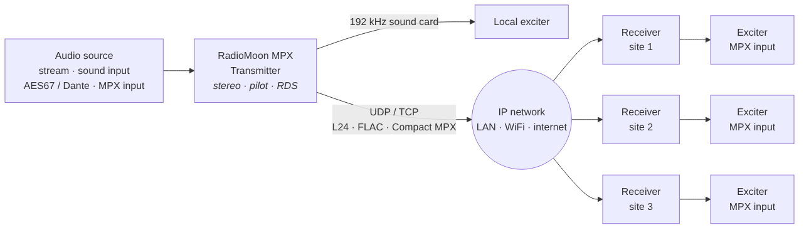

# RadioMoon MPX

Two programs for FM broadcasting over IP:

- **RadioMoon MPX Transmitter** – takes audio (internet stream, sound input, AES67 / Dante, or a ready MPX signal), builds the FM multiplex (stereo, 19 kHz pilot, RDS) and sends it to any number of sites over IP and / or to a 192 kHz sound card.
- **RadioMoon MPX Receiver** – at the transmitter site: receives the stream and plays the MPX on a 192 kHz sound card into the exciter's MPX input.

| | |
|---|---|
|  |  |
| Transmitter window – IP outputs | Receiver window – SFN |

## Start here

1. **Install** – step by step for your system:
   [[Install on Windows]] · [[Install on macOS]] · [[Install on Linux Desktop]] · [[Headless and Web Interface]] (servers) · [[Alpine Linux]] · [[AlmaLinux]] · [[Raspberry Pi]]
2. **[[First Steps]]** – the first link Transmitter → Receiver in 10 minutes.
3. **The programs** – [[Transmitter]] · [[Receiver]] · [[Web Interface]] · [[CLAP Plug-in]]
4. **Links and networks** – [[IP Transport and Formats]] · [[WiFi and Internet Links]] · [[Protection]] (encryption, FEC, allowed senders) · [[SFN]]
5. **More** – [[AM Mode]] · [[RDS]] · [[Backup Source]] · [[Receiver Log]] · [[Service and Tray]] · **Tips:** [[Tips]] — [[Station Logos in Cars]] · [[QoS on Windows]] · [[Troubleshooting]]

Downloads: [Releases](https://github.com/nikosbatsikas/radiomoon-mpx/releases) · Changes: [CHANGELOG](https://github.com/nikosbatsikas/radiomoon-mpx/blob/main/CHANGELOG.md)
