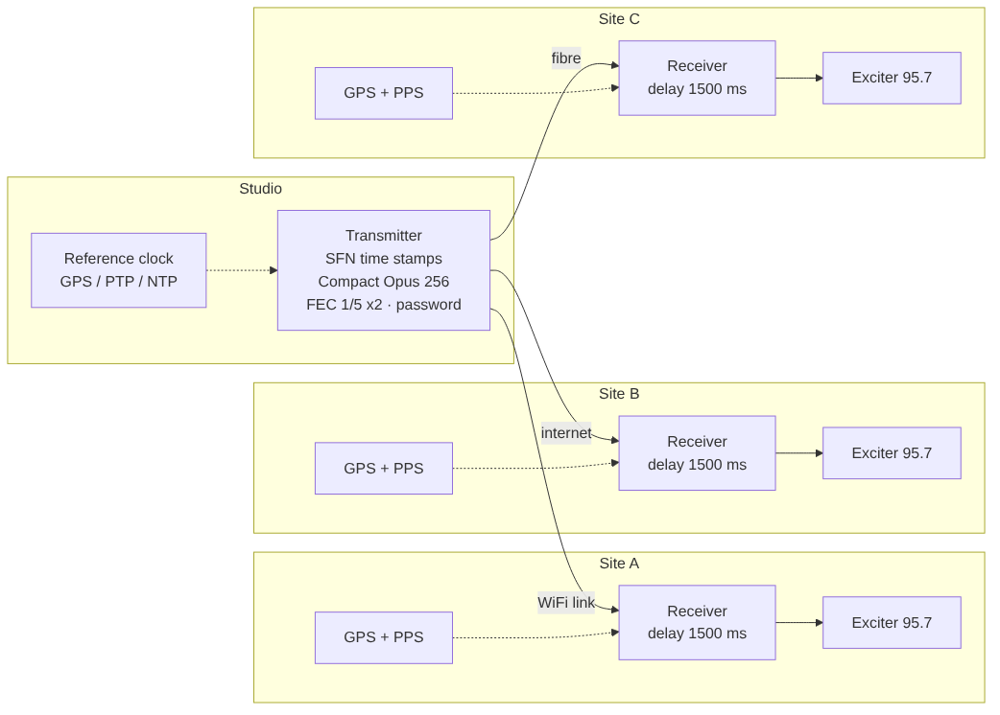
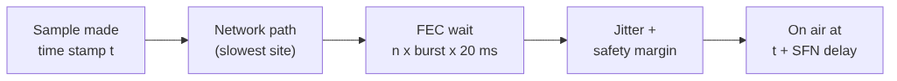

# SFN (single frequency network)

Several transmitters on the same frequency must put the same sample on air at the same moment. The Transmitter stamps every packet with the UTC time of its first sample; every Receiver plays it at *stamp + delay* by its reference clock.

1. **Transmitter**, SFN tab: *Send SFN time stamps*, choose the reference clock. Every UDP packet carries the UTC time of its first sample (RTP header extension, profile 0x524D).
2. **Every Receiver**, SFN tab: *Play every sample at its time stamp + delay*, the same reference clock and the **same delay** at all sites (longer than the slowest path; see *Arrival margin*). Calibrate each site's *Output correction* once (sound card, exciter, cables).

**Reference clocks:** *System clock* (best when the computer is synchronised by PTP — ptp4l + phc2sys — or GPS PPS with gpsd + chrony), the built-in *PTP* client (IEEE 1588v2 default profile, ports 319 / 320, about ±10–100 µs), or a *GPS receiver* on a serial port (NMEA; with PPS on DCD about ±0.1–1 ms).

UDP only. For WiFi / internet links see [[WiFi and Internet Links]].

UDP only. The Receiver follows the stamps with a fine resampler, so its sound card clock does not matter. The [[Backup Source]] plays without time stamps.

## Check
- **Locked** (green): the timing error stays within a few µs.
- *Not playing: …*: the sound card does not play (it must support **192 kHz**). For a test without such a card choose the output *No sound card (test output)*.
- *Arrival margin longer than the delay*: the Transmitter's clock runs ahead of the Receiver's — synchronise the clocks (NTP / chrony at least; GPS PPS or PTP for real SFN).
- *Late*: the packets arrive after their playout time — increase the delay.
- *The clock was stepped …*: a time service sets the clock in steps (e.g. the Windows time service). Every step moves this site against the others; use a service that adjusts smoothly (chrony, ptp4l + phc2sys, Meinberg NTP on Windows) or GPS / PTP as the reference clock.
- *Restarts* with *Last restart: the playout was … ms off*: the timing jumped by more than 20 ms (a clock step, the sound card stopped, or a very busy computer).
